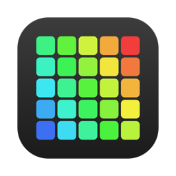
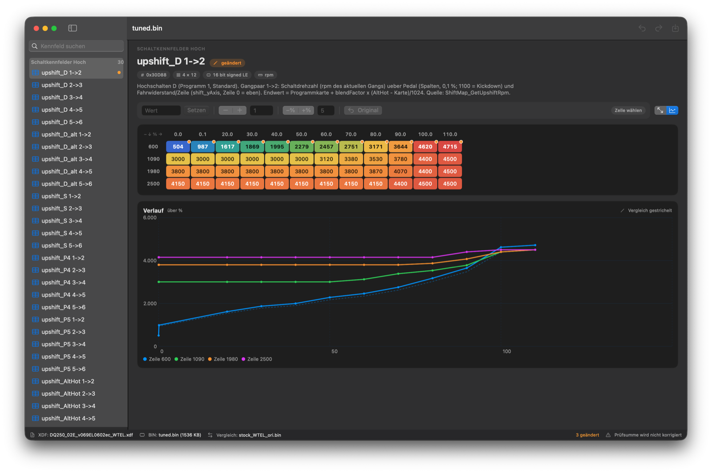
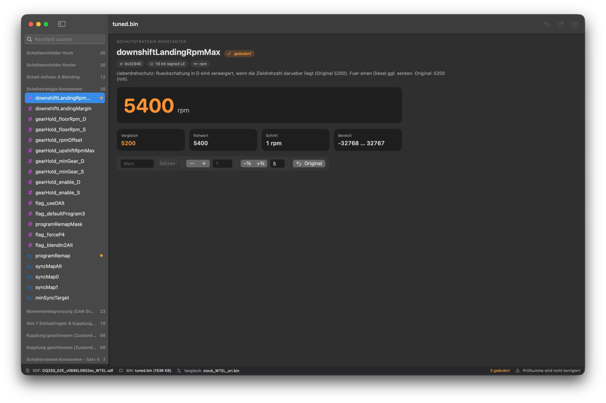
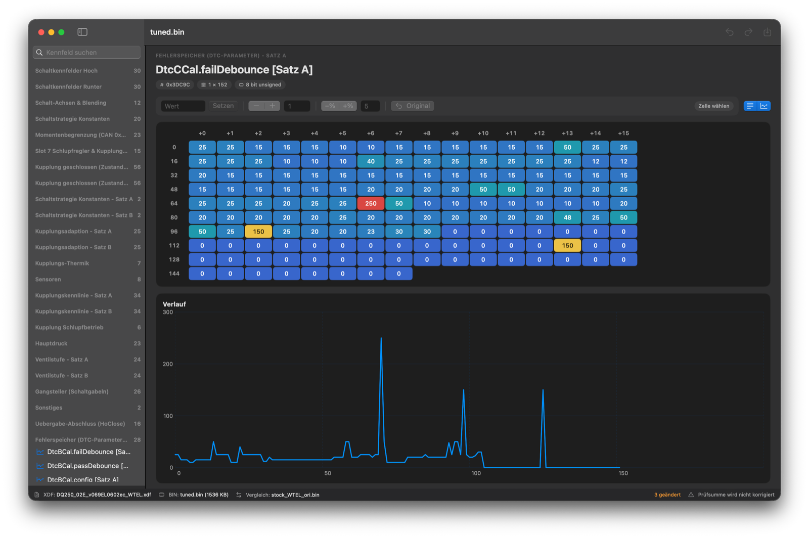

<p align="center">
  
</p>

<h1 align="center">MacTuner</h1>

<p align="center">
  Nativer XDF-Editor für macOS: TunerPro-Definitionen öffnen, Kennfelder und Werte in der Bin bearbeiten.<br>
  <sub>Native macOS editor for TunerPro XDF definitions and ECU/TCU binaries (UI in German).</sub>
</p>

<p align="center">
  <a href="../../releases/latest"></a>
  
  
  
  
</p>



TunerPro gibt es nur für Windows. MacTuner ist eine native SwiftUI-App ohne Wine, VM oder Abhängigkeiten.
Sie liest dieselben XDF-Dateien und schreibt eine Bin, in der nur die Bytes der bearbeiteten Werte geändert sind.

## Funktionen

- **Kennfelder als Heatmap**: Achsen werden aus der Bin gelesen oder als Labels angezeigt. Lange 1×N-Tabellen werden umgebrochen, 2D-Kennfelder lassen sich transponieren.
- **Verlauf als Diagramm**: Jede Zeile wird als Linie gezeichnet, der Vergleichsstand gestrichelt darunter.
- **Vergleich mit einer zweiten Bin**, etwa der Original-Bin. Ohne Vergleichsdatei gilt der Stand beim Öffnen. Geänderte Zellen bekommen einen orangen Punkt, und in der Liste lässt sich „Nur geänderte“ filtern.
- **Bearbeiten wie in einer Tabellenkalkulation**:
  - Bereiche auswählen, Zahl tippen und mit ↩ setzen.
  - **+ / −** ändert um die Schrittweite, außerdem prozentual oder zurück aufs Original.
  - Undo und Redo.
- **Konstanten** mit großer Wertanzeige, Rohwert, Schrittweite und Wertebereich.
- **Suche** über Titel und Beschreibungen, Kategorien wie in der XDF.
- Merkt sich XDF, Bin und Auswahl. Dateien lassen sich auch einfach ins Fenster ziehen.

| Konstante | Lange Tabelle (1 × 152) |
|---|---|
|  |  |

## Installation

1. `MacTuner-x.y.z.zip` von den [Releases](../../releases/latest) laden und entpacken. Das Archiv enthält eine Universal-App für Apple Silicon und Intel.
2. `MacTuner.app` nach `/Applications` ziehen.
3. Die App ist nicht notarisiert. Beim ersten Start blockiert macOS sie deshalb. Gib sie unter **Systemeinstellungen → Datenschutz & Sicherheit → „Dennoch öffnen“** frei. Alternativ im Terminal:
   ```sh
   xattr -dr com.apple.quarantine /Applications/MacTuner.app
   ```

## Bedienung

| Taste | Aktion |
|---|---|
| ⌘O / ⇧⌘O / ⌥⌘O | XDF / Bin / Vergleichs-Bin öffnen |
| ⌘S / ⇧⌘S | Speichern / Speichern unter |
| ⌘Z / ⇧⌘Z | Widerrufen / Wiederholen |
| Klick, ⇧-Klick, ⌘-Klick | Zelle, Bereich, einzelne Zellen wählen |
| Klick auf Achse / Ecke, ⌘A | ganze Zeile oder Spalte / alles wählen |
| Pfeiltasten (mit ⇧) | Auswahl bewegen (erweitern) |
| Zahl tippen + ↩ | Wert setzen |
| + / − | um die Schrittweite ändern |

> [!WARNING]
> **Die Prüfsumme wird nicht korrigiert.** Lass sie vor dem Flashen von deinem Flash-Tool korrigieren.
> Falsche Werte können Motor oder Getriebe beschädigen. Die Nutzung erfolgt auf eigene Gefahr.

## Unterstützter XDF-Umfang

Unterstützt wird der Teil des Formats TunerPro XDF 1.60, den übliche Definitionen nutzen:

- `XDFTABLE` mit X-, Y- und Z-Achse sowie `XDFCONSTANT`, Kategorien, Beschreibungen.
- Datentypen: 8, 16 und 32 Bit, signed und unsigned, Little und Big Endian, Spalten-Major, Float.
- Umrechnungsformeln über `X` mit `+ - * / ^` und Klammern. Für die Rückrechnung beim Bearbeiten wird die Formel invertiert, notfalls numerisch per Bisektion.
- Ausgabe als Zahl oder Hex. Achsen kommen aus der Bin, aus Labels oder sind einfache Indizes.

Nicht unterstützt sind Flags/Bitmasken (`XDFFLAG`), Patches, Checksummen-Plugins und ADX/Datalogging.

## Bauen

Zum Bauen genügen die Command Line Tools, Xcode ist nicht nötig.

```sh
./build_app.sh            # → build/MacTuner.app (universal)
```

Das macOS-27-SDK der Command Line Tools enthält das SwiftUI-Makro-Plugin nicht. Ohne Xcode nimmt das Skript deshalb automatisch das 26er-SDK.

### Selbsttests

Sind eine XDF und eine passende Bin vorhanden, laufen beim Bauen zwei Tests:

```sh
MACTUNER_XDF=def.xdf MACTUNER_BIN=stock.bin ./build_app.sh
```

- `--check <xdf> <bin>`
  - liest jeden Eintrag;
  - vergleicht Konstanten mit den Angaben „Original: N (roh)“ in den Beschreibungen;
  - kodiert jede Zelle neu und erwartet dabei exakt dieselben Bytes.
- `--edit-test <xdf> <bin> <out>`
  - bearbeitet einige Werte über denselben Code wie die App;
  - speichert die Datei;
  - vergleicht sie Byte für Byte mit dem Original. Nur die beabsichtigten Bytes dürfen sich unterscheiden.

## Lizenz

[MIT](LICENSE). Nicht mit TunerPro verbunden. Es werden keine XDF- oder Bin-Dateien mitgeliefert.
