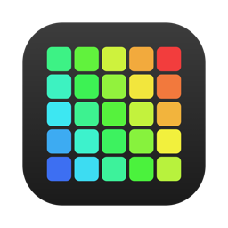
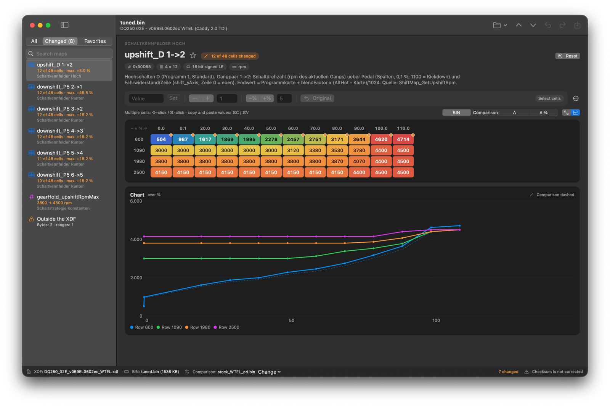
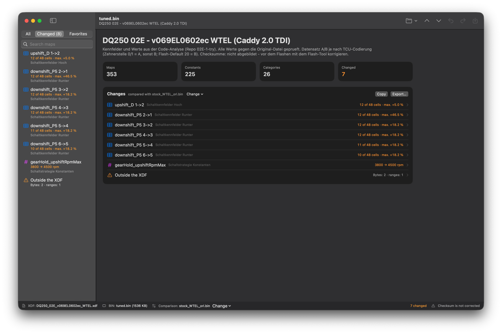
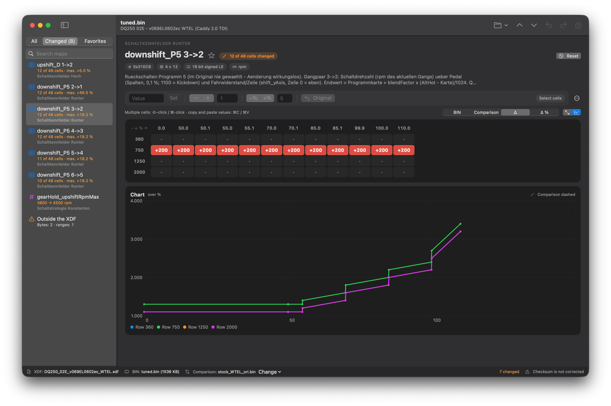
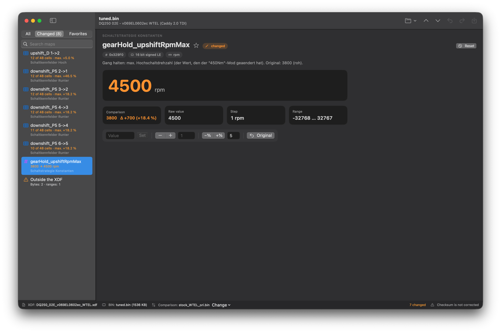

<p align="center">
  
</p>

<h1 align="center">MacTuner</h1>

<p align="center">
  A native macOS editor for TunerPro XDF definitions: open the definition, then edit maps and values in the binary.
</p>

<p align="center">
  <a href="../../releases/latest"></a>
  
  
  
  
  
</p>



TunerPro only runs on Windows. MacTuner is a native SwiftUI app that runs without Wine, a VM or any dependencies.
It reads the same XDF files. When it saves the binary, only the bytes of the values you edited change.

## Features

- **Maps as heatmaps.** Axes are read from the binary or shown as labels. Long 1×N tables wrap into rows, and 2D maps can be transposed.
- **Charts.** Every row is drawn as a line, with the comparison drawn dashed underneath.
- **Comparison with a second binary**, such as the stock file. Without one, the app compares against the state when the file was opened.
  - **Changed** tab in the sidebar: one flat list of every changed map and value, with how many cells changed and the largest deviation.
    Changed axes count as changes, and bytes that changed outside the XDF (checksums, undefined maps) get their own entry.
  - Switch a table between **BIN · Comparison · Δ · Δ %**, or flip between BIN and comparison with Tab.
    The comparison view is read-only and framed in teal; Δ shows each cell's difference to the comparison.
  - Swap BIN and comparison to edit the other file.
  - Jump from change to change (⌥⌘↓ / ⌥⌘↑), reset a whole map to the comparison, or export the change list as text (⌘E).
- **Spreadsheet-style editing:**
  - Select a range, type a number and press ↩ to set it.
  - **+ / −** changes the selection by the step size. You can also change it by a percentage or reset it to the original.
  - **Copy and paste** (⌘C / ⌘V) as tab-separated text, compatible with Excel, Numbers and TunerPro. One value fills the whole selection.
  - **Interpolate** the selection horizontally, vertically or across the area from its four corners, using the axis values.
  - Min, max and average of the selection. Undo and redo.
- **Constants** with a large value display, raw value, step size and valid range.
- **Search** across titles, descriptions and addresses. Categories come from the XDF.
- **Favorites** (⌘D) for the maps you edit most, and an overview page with every change at a glance.
- Remembers the XDF, the binary, the comparison and the selection between launches, with a list of recent files. Files can also be dropped onto the window.

| Overview of all changes | Difference to the comparison (Δ) |
|---|---|
|  |  |
| **Comparison view (read-only, Tab)** | **Constant** |
|  |  |

## Languages

The interface is available in English, German, French, Spanish, Italian, Portuguese, Dutch, Swedish, Polish, Czech,
Slovenian, Croatian, Serbian, Romanian, Hungarian, Bulgarian, Greek, Turkish, Albanian, Ukrainian, Russian,
Chinese (Simplified and Traditional), Japanese and Korean.

MacTuner follows the system language and falls back to English. To use a different language for MacTuner only, go to
**System Settings → General → Language & Region → Applications**. Map names, descriptions and categories come from
the XDF and stay in the XDF's language.

All UI strings live in [`Localization/translations.py`](Localization/translations.py). After editing it, run
`python3 Localization/translations.py Localization`. This regenerates the `.strings` files and checks that every
language has all keys and matching placeholders.

## Installation

1. Download `MacTuner-x.y.z.zip` from [Releases](../../releases/latest) and unzip it. It contains a universal app for Apple Silicon and Intel.
2. Move `MacTuner.app` to `/Applications`.
3. The app is not notarized, so macOS blocks the first launch. Allow it under **System Settings → Privacy & Security → Open Anyway**, or run:
   ```sh
   xattr -dr com.apple.quarantine /Applications/MacTuner.app
   ```

## Usage

| Shortcut | Action |
|---|---|
| ⌘O / ⇧⌘O / ⌥⌘O | Open XDF / binary / comparison binary |
| ⌘S / ⇧⌘S | Save / Save As |
| ⌘Z / ⇧⌘Z | Undo / Redo |
| ⌘1 / ⌘2 / ⌘3 | Sidebar: all / changed / favorites |
| ⌥⌘↓ / ⌥⌘↑ | Next / previous change |
| ⌘0 | Overview |
| ⌘D | Add to / remove from favorites |
| ⌘E / ⇧⌘C | Export / copy the change list |
| Click, ⇧-click, ⌘-click | Select a cell, a range, individual cells |
| Click an axis / the corner, ⌘A | Select a whole row or column / everything |
| Arrow keys (with ⇧) | Move (extend) the selection |
| Type a number + ↩ | Set the value |
| + / − | Change by the step size |
| ⌘C / ⌘V | Copy / paste cells |
| Tab | Table: BIN ⇄ comparison |

> [!WARNING]
> **MacTuner does not correct checksums.** Let your flashing tool fix the checksum before you flash.
> Wrong values can damage the engine or transmission. Use at your own risk.

## Supported XDF features

MacTuner supports the parts of the TunerPro XDF 1.60 format that typical definitions use:

- `XDFTABLE` with X, Y and Z axes, `XDFCONSTANT`, categories and descriptions.
- Data types: 8, 16 and 32 bit, signed and unsigned, little and big endian, column-major, float.
- Conversion formulas in `X` with `+ - * / ^` and parentheses. When you edit a value, MacTuner inverts the formula, falling back to a numeric bisection if needed.
- Output as a number or as hex. Axes come from the binary or from labels, or default to plain indices.

Flags/bitmasks (`XDFFLAG`), patches, checksum plugins and ADX/datalogging are not supported.

## Roadmap

Where MacTuner is heading: from an XDF viewer to the tuning workbench for the Mac. The list is not in a fixed order,
and ideas and pull requests are welcome in [Issues](../../issues).

### Comparing and tracking changes
- [x] One list of every changed map and value, changed axes, bytes changed outside the XDF ([#1](../../issues/1))
- [x] BIN / comparison / Δ / Δ % view per table, jump from change to change, change list export
- [x] Compare three or more files side by side (stock, stage 1, stage 2 …)
- [x] Whole-file hex diff with the XDF items drawn over it (including live U8/U16 LE/BE byte inspector, diff-only filter, jump to address & copy hex)
- [x] Change history per map: every edit with time, old → new and a note, across sessions (plus global searchable history & CSV export)
- [x] Snapshots of a BIN with names ("before launch control"), restore or compare any two (plus export snapshot as BIN)
- [x] Printable / PDF change report with charts, for customers and documentation

### Editing
- [x] Copy and paste as tab-separated text, interpolation, selection statistics
- [x] 3D surface view of 2D maps, rotatable, editable by dragging points (with comparison ghost wireframe overlay)
- [x] Smooth the selection, fill down / up / right / left, flatten to a value, set to the average, clamp to min/max
- [x] Edit the axes like values, with a check that they stay monotonic
- [x] Copy a whole map from another file or another map with the same layout
- [x] Lock maps that must not change, and warn when values leave a safe range
- [x] Unit conversion (°C/°F, Nm/lb-ft, bar/kPa/psi, km/h/mph, λ/AFR) per user preference
- [x] Command palette (⌘K) for every action and every map

### Definitions
- [ ] `XDFFLAG` bitmasks as switches, `XDFPATCH` patches with apply / revert
- [ ] Built-in XDF editor: add and change maps, axes, formulas and categories, save the XDF
- [ ] Create a map straight from a selected address range
- [ ] Import A2L / DAMOS and WinOLS map packs (`.kp`), export them as XDF
- [ ] Notes per map that are stored next to the XDF and survive XDF updates
- [ ] Translate map names and descriptions of foreign-language XDFs on the fly

### Finding maps
- [ ] Map finder: detect tables and axes in unknown binaries by their structure, like WinOLS
- [ ] Find the same maps in another software version and port a tune across versions
- [ ] Apply a change list from one file to another (batch tuning)
- [ ] Highlight maps that look wrong: non-monotonic axes, outliers, cut-off curves

### Checksums and flashing
- [ ] Checksum plugins per control unit family (Bosch ME7 / MED17 / EDC17, Siemens, Temic DQ250 …)
- [ ] Check the checksum on open and before save, with a clear warning when it does not match
- [ ] Hand-off to common flash tools, with the right file layout and name

### Datalogging
- [ ] Load logs (CSV, ADX) and trace the visited cells live in the heatmap
- [ ] Hit-count overlay: which cells the engine actually uses, over a whole log
- [ ] Log-based suggestions, e.g. for fuel or shift maps from measured values

### Workflow and macOS
- [x] Favorites, recent files, overview page, search by address
- [ ] Projects: XDF, BIN, comparison, notes and snapshots in one file
- [ ] Several files open at once in tabs or windows
- [ ] Quick Look and Finder previews for `.xdf` and `.bin`
- [ ] Shortcuts and AppleScript actions, plus a `mactuner` command line (diff, apply, export)
- [ ] Plugins in JavaScript for custom checksums, importers and tools
- [ ] iPad version for reviewing and small edits on the road

### Quality and distribution
- [x] 25 languages
- [ ] Notarized builds and automatic updates
- [ ] Homebrew cask (`brew install --cask mactuner`)
- [ ] VoiceOver support and color-blind friendly heatmap palettes
- [ ] Test suite with public sample definitions for every supported data type

## Building

The Command Line Tools are enough; Xcode is not required.

```sh
./build_app.sh            # → build/MacTuner.app (universal)
```

The macOS 27 SDK that ships with the Command Line Tools lacks the SwiftUI macro plugin. Without Xcode, the script therefore uses the macOS 26 SDK automatically.

### Self-tests

If you have an XDF and a matching binary, the build also runs these tests (the third one only with `MACTUNER_CMP`):

```sh
MACTUNER_XDF=def.xdf MACTUNER_BIN=stock.bin MACTUNER_CMP=tuned.bin ./build_app.sh
```

- `--check <xdf> <bin>`
  - reads every item;
  - compares constants with the "Original: N (roh)" values in their descriptions;
  - re-encodes every cell and expects exactly the same bytes.
- `--edit-test <xdf> <bin> <out>`
  - edits a few values through the same code the app uses;
  - saves the file;
  - compares it byte by byte with the original. Only the intended bytes may differ.
- `--changes <xdf> <bin> <compare>`
  - prints the change list exactly as the app exports it;
  - checks the changed maps, cells and bytes outside the XDF against a plain byte comparison;
  - checks interpolation and the parsing of pasted text.

## Contributing

Issues and pull requests are welcome. The short version is in [CONTRIBUTING.md](CONTRIBUTING.md).

## License

[MIT](LICENSE). Not affiliated with TunerPro. No XDF or binary files are included.
