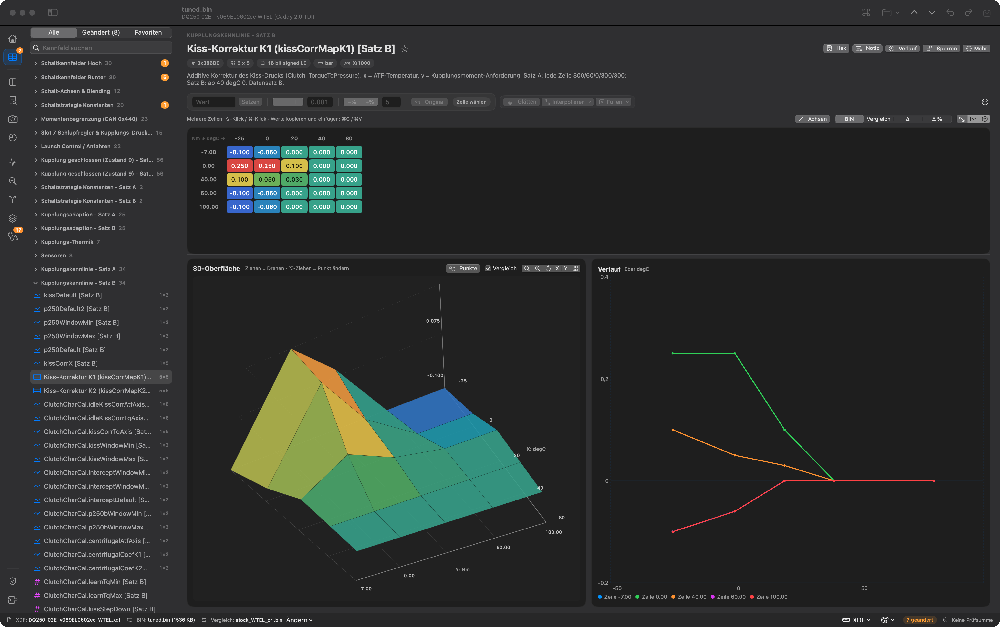
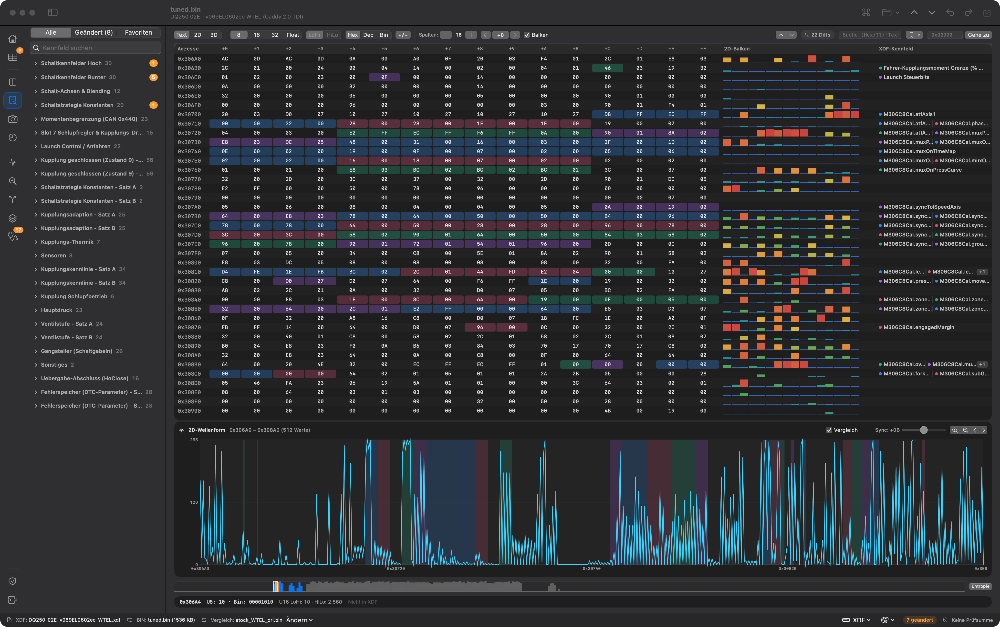
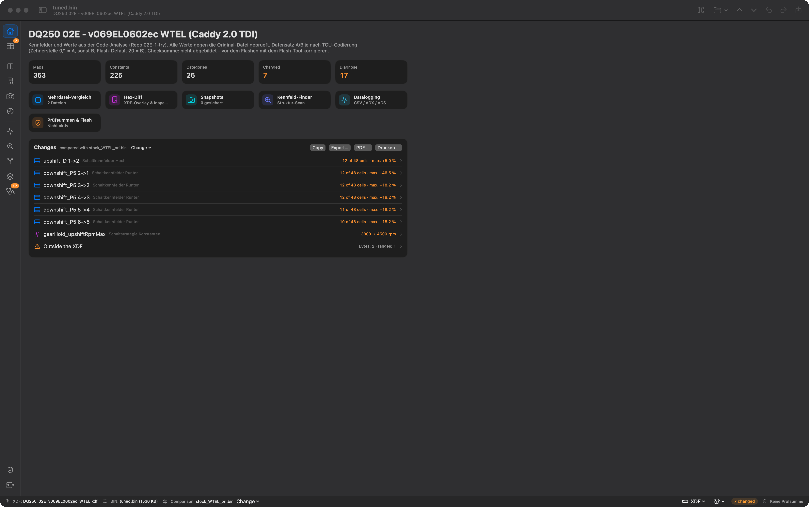
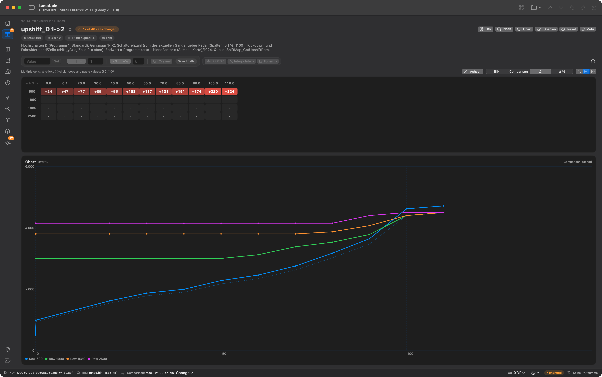
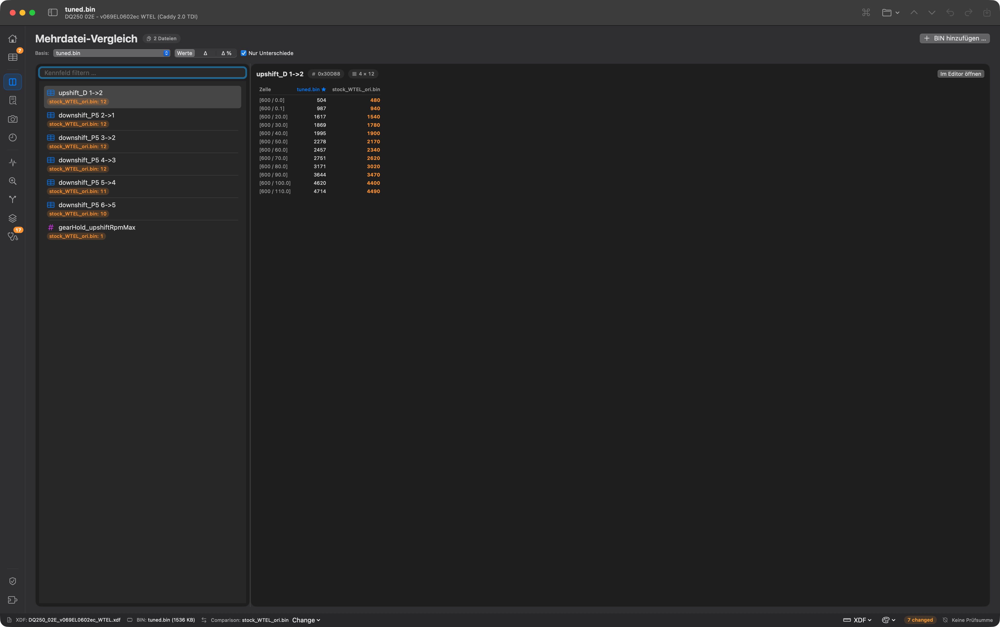

<p align="center">
  
</p>

<h1 align="center">MacTuner</h1>

<p align="center">
  A native macOS ECU &amp; TCU tuning workbench: edit TunerPro XDF definitions (v1.60 XML &amp; legacy v1.11), A2L/DAMOS and WinOLS map packs, inspect binaries in 60-FPS Hex / 2D / 3D, compare files, log data, and verify checksums — no Wine, no VM, zero dependencies.
</p>

<p align="center">
  <a href="../../releases/latest"></a>
  
  
  
  
  
</p>



TunerPro and WinOLS only run on Windows. **MacTuner** is a native SwiftUI tuning workbench built from the ground up for macOS. When saving a binary, only the exact bytes of edited values change.

## Highlights

- **Heatmap, 2D Charts &amp; Interactive 3D Surface.** Edit 1D curves and 2D maps with color-blind-friendly palettes (Classic, Viridis, Cividis, Plasma, High Contrast), drag vertices live in 3D with camera-facing X/Y/Z axes and comparison wireframe overlays, wrap long 1×N tables, or transpose rows and columns.
- **WinOLS-Class 60-FPS Binary Analyzer.** Windowed GPU-backed Hexdump with `8 / 16 / 32 / Float`, `LoHi / HiLo`, `Hex / Dec`, `Signed / Unsigned`, adjustable column width, element-aligned &amp; odd-byte offset shifting, inline per-row 2D bar-graphs, zoomable 2D waveform with drag-to-select &amp; offset-sync slider, live 3D preview, whole-file minimap + Shannon entropy map, wildcard (`??`) search, bookmarks, twin-map detector, and double-click to jump straight to any XDF map.
- **Multi-File Compare, Snapshots &amp; History.** Compare 3+ binaries side by side (Stock, Stage 1, Stage 2, Snapshots), inspect **BIN · Comparison · Δ · Δ %** per table, save named snapshots, track per-map edit history with notes across sessions, and export printable multi-page **PDF reports with charts** (`⌘P` / `⇧⌘E`).
- **Spreadsheet-Style Editing &amp; Safety.** Type values directly, step with `+ / −`, scale by `%`, copy/paste TSV (`⌘C / ⌘V`), interpolate horizontally/vertically/bilinearly, axis-aware smooth, fill down/up/right/left, flatten, clamp, edit axes inline with live monotonicity checks, lock maps (`⌘L`), set safe min/max ranges, and convert units on the fly (`°C/°F`, `Nm/lb-ft`, `bar/kPa/psi`, `km/h/mph`, `λ/AFR`).
- **Definitions &amp; Map Finding.** Reads **XDF 1.60 XML**, **legacy XDF v1.11 text**, **A2L / DAMOS**, and **WinOLS `.kp` / `.csv`** map packs — including `XDFTABLE`, `XDFCONSTANT`, `XDFFLAG` switches, and `XDFPATCH` apply/revert. Includes a built-in XDF editor, create-map-from-selection, sidecar map notes, on-the-fly ECU glossary translation, structure-based Map Finder, cross-version tune porting, `.mtpatch` batch tuning, and automatic map diagnostics.
- **Checksums, Datalogging &amp; Automation.** Built-in checksum plugins (Bosch ME7 / MED17 / EDC17, Siemens MS4x/SIMOS, Temic DQ250, generic CRC-32) with open/pre-save verification and flash-tool export presets (KESS, KTAG, PCMFlash, Flex, CMDFlash, MPPS); CSV/ADX/ADS datalog playback with live heatmap trace, hit-count overlay &amp; tuning suggestions; `.mtproj` projects, multi-window tabs, `⌘K` Command Palette, `mactuner` CLI, Shortcuts/AppleScript, and JavaScript plugins (`JavaScriptCore`).

| WinOLS-class Hexdump, 2D Bar-Graph &amp; Waveform | Overview &amp; Workbench |
|---|---|
|  |  |
| **Difference view (Δ)** | **Multi-File Compare (3+ binaries)** |
|  |  |

## Languages

The interface is available in English, German, French, Spanish, Italian, Portuguese, Dutch, Swedish, Polish, Czech,
Slovenian, Croatian, Serbian, Romanian, Hungarian, Bulgarian, Greek, Turkish, Albanian, Ukrainian, Russian,
Chinese (Simplified and Traditional), Japanese and Korean.

MacTuner follows the system language and falls back to English. To use a different language for MacTuner only, go to
**System Settings → General → Language &amp; Region → Applications**. Map names, descriptions and categories come from
the XDF and can optionally be translated on the fly via the built-in ECU glossary.

All UI strings live in [`Localization/translations.py`](Localization/translations.py) and, for 2.x, [`translations_v2.py`](Localization/translations_v2.py). After editing them, run
`python3 Localization/translations.py Localization`.

## Installation

1. Download `MacTuner-2.3.1.zip` from [Releases](../../releases/latest) and unzip it (universal binary for Apple Silicon &amp; Intel).
2. Move `MacTuner.app` to `/Applications`.
3. Because the release is unsigned/not notarized, allow the first launch under **System Settings → Privacy &amp; Security → Open Anyway**, or run:
   ```sh
   xattr -dr com.apple.quarantine /Applications/MacTuner.app
   ```

A Homebrew Cask formula is also included in [`Casks/mactuner.rb`](Casks/mactuner.rb).

## Shortcuts &amp; CLI

| Shortcut | Action |
|---|---|
| `⌘K` | Command Palette (search every map, address &amp; action) |
| `⌘O` / `⇧⌘O` / `⌥⌘O` | Open XDF / binary / comparison binary |
| `⌘S` / `⇧⌘S` | Save / Save As |
| `⌘Z` / `⇧⌘Z` | Undo / Redo |
| `⌘0` / `⌘4` / `⌘5` / `⌘6` / `⌘7` | Overview / Multi-Compare / Hex-Diff / Snapshots / History |
| `⌘1` / `⌘2` / `⌘3` | Sidebar: All / Changed / Favorites |
| `⌥⌘↓` / `⌥⌘↑` | Next / previous changed map |
| `⌘D` / `⌘L` | Toggle favorite / toggle write-lock |
| `⌘E` / `⇧⌘E` / `⌘P` | Export text report / export PDF report / print |
| `Tab` | Table: BIN ⇄ Comparison |
| Click, `⇧`-click, `⌘`-click, `⌘A` | Select cell, range, individual cells, or all |
| Type number + `↩`, `+` / `−`, `⌘C` / `⌘V` | Set value, step, copy/paste TSV |

The bundled [`scripts/mactuner`](scripts/mactuner) CLI exposes headless automation:
```sh
mactuner diff <xdf> <bin> <compare>
mactuner export <xdf> <bin> <compare> <report.pdf|report.txt>
mactuner apply <xdf> <tune.mtpatch> <in.bin> <out.bin> [--mode absolute|delta|percent]
mactuner checksum <bin> [--plugin bosch-me7|bosch-med17|siemens-simos|temic-dq250] [--fix out.bin]
mactuner convert <in.a2l|in.kp> <out.xdf>
mactuner info <xdf>
```

> [!WARNING]
> **Always verify checksums with your flashing tool before flashing.**
> Wrong calibration values or checksums can damage the engine or transmission. Use at your own risk.

## Supported Formats

- **Definitions:** TunerPro XDF 1.60 XML (`XDFTABLE`, `XDFCONSTANT`, `XDFFLAG`, `XDFPATCH`), legacy TunerPro XDF v1.11 text format, ASAP2 `.a2l` / DAMOS, and WinOLS `.kp` / `.csv` map packs.
- **Data types:** 8, 16 and 32 bit, signed and unsigned, little and big endian, column-major, 32-bit IEEE float, hex output, embedded &amp; label axes, and arbitrary `X` equations (`+ - * / ^ ()`) with exact linear inversion and numeric bisection fallback.
- **Datalogs:** CSV (auto-delimiter), TunerPro v5 `.adx`, and legacy TunerPro v4 `.ads`.
- **Projects &amp; Patches:** Single-file `.mtproj` projects and `.mtpatch` batch tune packages.

## Roadmap

Where MacTuner is heading: from an XDF viewer to the tuning workbench for the Mac. The list is not in a fixed order,
and ideas and pull requests are welcome in [Issues](../../issues).

### Comparing and tracking changes
- [x] One list of every changed map and value, changed axes, bytes changed outside the XDF ([#1](../../issues/1))
- [x] BIN / comparison / Δ / Δ % view per table, jump from change to change, change list export
- [x] Compare three or more files side by side (stock, stage 1, stage 2 …)
- [x] Whole-file hex diff with the XDF items drawn over it (including live U8/U16 LE/BE byte inspector, diff-only filter, jump to address & copy hex)
- [x] Change history per map: every edit with time, old → new and a note, across sessions (plus global searchable history & CSV export)
- [x] Snapshots of a BIN with names ("before launch control"), restore or compare any two (plus export snapshot as BIN)
- [x] Printable / PDF change report with charts, for customers and documentation

### Editing
- [x] Copy and paste as tab-separated text, interpolation, selection statistics
- [x] 3D surface view of 2D maps, rotatable, editable by dragging points (with comparison ghost wireframe overlay)
- [x] Smooth the selection, fill down / up / right / left, flatten to a value, set to the average, clamp to min/max
- [x] Edit the axes like values, with a check that they stay monotonic
- [x] Copy a whole map from another file or another map with the same layout
- [x] Lock maps that must not change, and warn when values leave a safe range
- [x] Unit conversion (°C/°F, Nm/lb-ft, bar/kPa/psi, km/h/mph, λ/AFR) per user preference
- [x] Command palette (⌘K) for every action and every map

### Definitions
- [x] Legacy TunerPro XDF v1.11 text format parser (in addition to XML XDF 1.60)
- [x] `XDFFLAG` bitmasks as switches, `XDFPATCH` patches with apply / revert
- [x] Built-in XDF editor: add and change maps, axes, formulas and categories, save the XDF
- [x] Create a map straight from a selected address range (in Hex-Diff or Outside-XDF changes)
- [x] Import A2L / DAMOS and WinOLS map packs (`.kp` / `.csv`), export them as XDF
- [x] Notes per map that are stored next to the XDF and survive XDF updates
- [x] Translate map names and descriptions of foreign-language XDFs on the fly (including Bosch/Siemens ECU acronym glossary)

### Finding maps
- [x] Map finder: detect tables and axes in unknown binaries by their structure, like WinOLS (with live mini-heatmap preview & one-click add to XDF)
- [x] Find the same maps in another software version and port a tune across versions (exports relocated XDF and ported BIN)
- [x] Apply a change list from one file to another (batch tuning with `.mtpatch` packages in absolute, Δ or Δ% mode)
- [x] Highlight maps that look wrong: non-monotonic axes, outliers, cut-off curves and out-of-bounds addresses

### WinOLS-class Binary Analysis & Reverse Engineering
- [x] 60-FPS windowed Hexdump with 8/16/32-bit, Float, LoHi/HiLo, Hex/Dec, and Signed/Unsigned toggles
- [x] Adjustable column width (`M`/`W`) and byte-offset alignment shift (`±1` byte) to snap unknown maps into alignment
- [x] Inline per-row bar-graph visualization right next to hex/decimal values (spot maps visually while scrolling)
- [x] Zoomable 2D waveform graph (bottom dock & full 2D view) with click-to-scroll and drag-to-select byte ranges
- [x] Whole-file minimap overview bar showing data density, XDF coverage and diff locations for instant navigation
- [x] Live 3D surface toggle directly on the current hexdump window or selection
- [x] Byte-sequence, wildcard (`??`), ASCII and numeric value-range search in hexdump
- [x] Bookmarks & named address markers in hexdump with quick jump
- [x] Twin-map / parallel-map detector (find identical or mirrored calibration blocks in the same BIN)
- [x] Entropy & code-vs-calibration region map (separate executable code, calibration tables, empty flash and strings)
- [ ] Automatic Bosch / Siemens / Marelli / Denso pointer & axis-ID descriptor decoder
- [x] Synchronized 2D waveform comparison of two different software versions with manual offset-sync slider

### Checksums and flashing
- [x] Checksum plugins per control unit family (Bosch ME7 / MED17 / EDC17, Siemens MS4x/SIMOS, Temic DQ250, generic CRC-32)
- [x] Check the checksum on open and before save, with a clear warning when it does not match (plus one-click undoable correction & live StatusBar indicator)
- [x] Hand-off to common flash tools (KESS, KTAG/Bench, PCMFlash, Flex, CMDFlash, MPPS), with the right file layout, padding, changelog sidecar and name

### Datalogging
- [x] Load logs (CSV, ADX, legacy TunerPro v4 ADS) and trace the visited cells live in the heatmap (with inline playback scrubber & auto-channel matching)
- [x] Hit-count overlay: which cells the engine actually uses, over a whole log
- [x] Log-based suggestions, e.g. for fuel (multiplicative) or shift/boost maps (additive) from measured values with min-hits & damping control

### Workflow and macOS
- [x] Favorites, recent files, overview page, search by address
- [x] Projects (`.mtproj`): XDF, BIN, comparison, notes, history and snapshots in one file
- [x] Several files open at once in tabs or windows (`WindowGroup` + native macOS window tabbing)
- [x] Quick Look and Finder previews for `.xdf`, `.bin` and `.mtproj`
- [x] Shortcuts (`AppIntents`) and AppleScript (`MacTuner.sdef`) actions, plus a `mactuner` command line (`diff`, `apply`, `export`, `info`, `checksum`, `convert`)
- [x] Plugins in JavaScript (`JavaScriptCore`) for custom checksums and tools
- [x] iPad version (`iPad/MacTunerPadApp.swift`) for reviewing and small edits on the road

### Quality and distribution
- [x] 25 languages
- [x] Notarized builds (`scripts/notarize.sh`) and automatic updates (GitHub Releases update checker)
- [x] Homebrew cask (`Casks/mactuner.rb` for `brew install --cask mactuner`)
- [x] VoiceOver support and color-blind friendly heatmap palettes (Viridis, Cividis, Plasma, High Contrast)
- [x] Test suite (`--self-test`) with public sample definitions (`Samples/all_datatypes.xdf`) for every supported data type

## Building

The Command Line Tools are enough; Xcode is not required.

```sh
./build_app.sh            # → build/MacTuner.app (universal)
```

The macOS 27 SDK that ships with the Command Line Tools lacks the SwiftUI macro plugin. Without Xcode, the script therefore uses the macOS 26 SDK automatically.

### Self-tests

If you have an XDF and a matching binary, the build also runs these tests (the third one only with `MACTUNER_CMP`):

```sh
MACTUNER_XDF=def.xdf MACTUNER_BIN=stock.bin MACTUNER_CMP=tuned.bin ./build_app.sh
```

- `--check <xdf> <bin>`
  - reads every item;
  - compares constants with the "Original: N (roh)" values in their descriptions;
  - re-encodes every cell and expects exactly the same bytes.
- `--edit-test <xdf> <bin> <out>`
  - edits a few values through the same code the app uses;
  - saves the file;
  - compares it byte by byte with the original. Only the intended bytes may differ.
- `--changes <xdf> <bin> <compare>`
  - prints the change list exactly as the app exports it;
  - checks the changed maps, cells and bytes outside the XDF against a plain byte comparison;
  - checks interpolation and the parsing of pasted text.

## Contributing

Issues and pull requests are welcome. The short version is in [CONTRIBUTING.md](CONTRIBUTING.md).

## License

[MIT](LICENSE). Not affiliated with TunerPro. No XDF or binary files are included.
