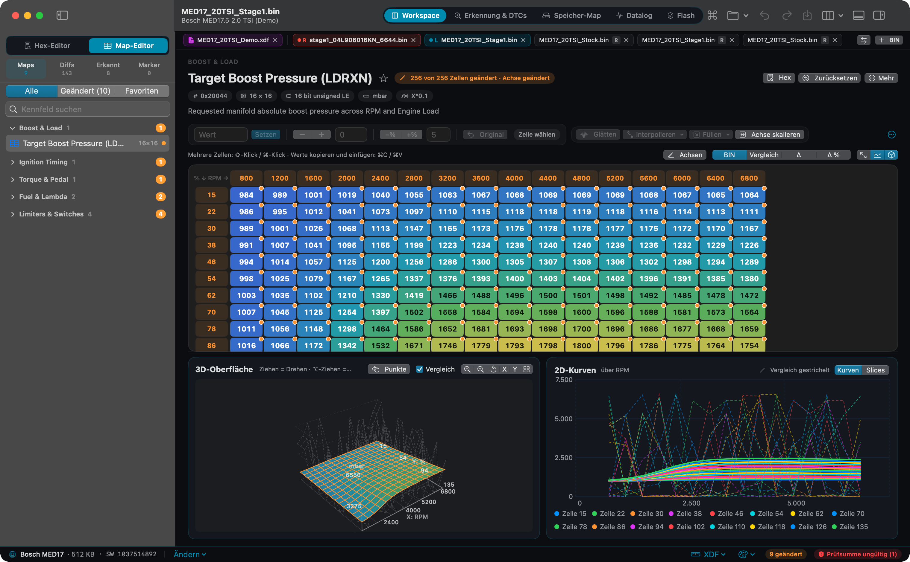
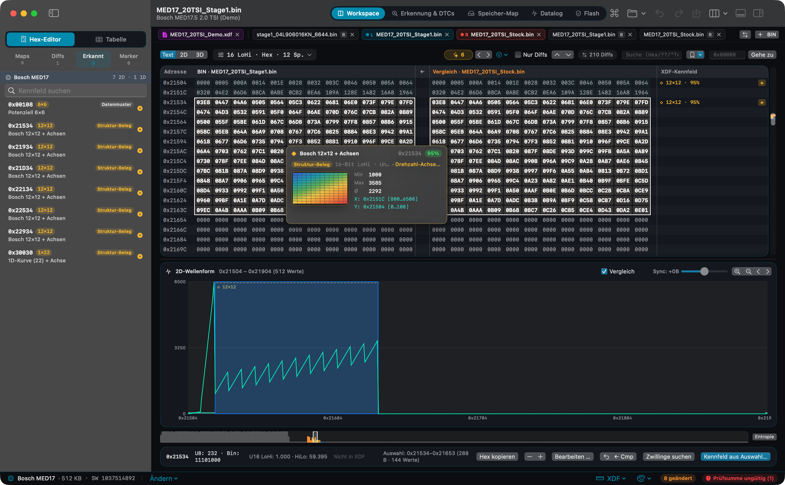
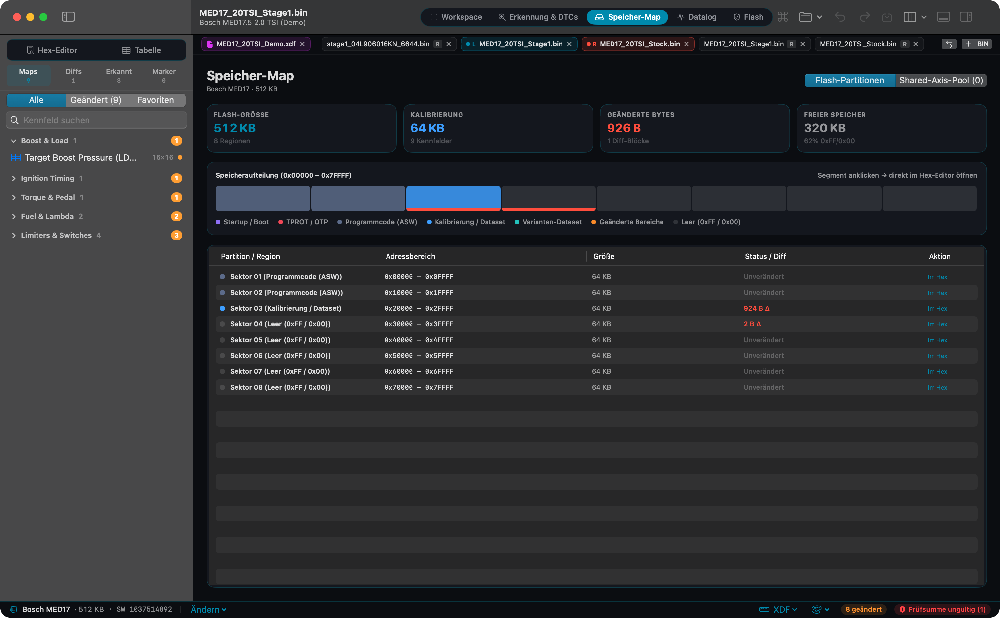
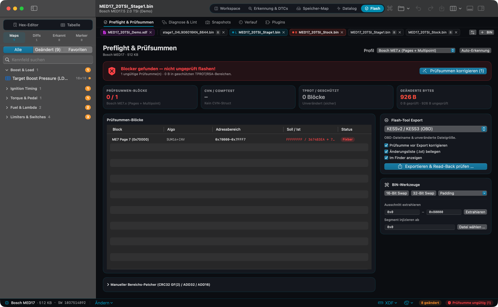
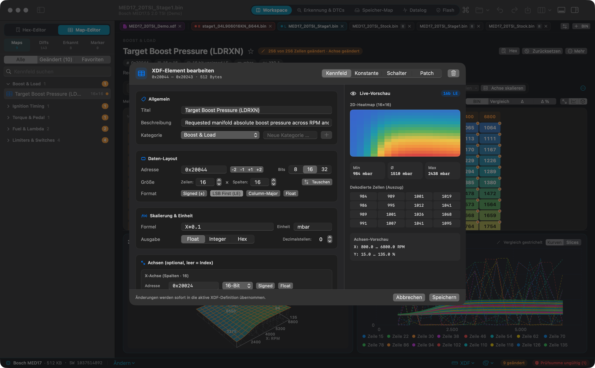
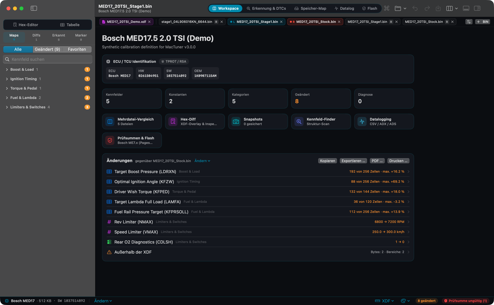

<p align="center">
  
</p>

<h1 align="center">MacTuner</h1>

<p align="center">
  <strong>A native macOS ECU &amp; TCU tuning workbench.</strong><br>
  WinOLS-class 60-FPS Hex &amp; Map Recognition · TunerPro XDF, A2L/DAMOS &amp; WinOLS Map Packs · Interactive 3D Surfaces · OEM DTC Switcher · Virtual Road Dyno · Checksums — no Wine, no VM, zero dependencies.
</p>

<p align="center">
  <a href="../../releases/latest"></a>
  
  
  
  
  
</p>

<p align="center">
  <a href="#gallery">Gallery</a> ·
  <a href="#highlights">Highlights</a> ·
  <a href="#installation">Installation</a> ·
  <a href="#shortcuts--cli">Shortcuts &amp; CLI</a> ·
  <a href="#supported-formats">Formats</a> ·
  <a href="#building">Building</a>
</p>



TunerPro and WinOLS only run on Windows. **MacTuner** is a native SwiftUI &amp; AppKit tuning workbench engineered from the ground up for macOS. Every edit is non-destructive and byte-exact: when saving a binary, only the exact bytes of edited values change.

---

## Gallery

| **WinOLS-Class Split Hex-Diff &amp; In-Hex Map Recognition** | **Visual Memory Atlas &amp; Shared-Axis Pool** |
|---|---|
|  |  |
| **Preflight, Checksums, CVN &amp; Flash-Tool Export** | **2-Column Live-Preview XDF Editor** |
|  |  |
| **Overview, ECU Identification &amp; Change Summary** | **Map Editor: Heatmap, 3D Surface &amp; 2D Curves** |
|  |  |

---

## Highlights

### Redesigned v3.0 Pro Workbench &amp; Visual Architecture
- **3 Adaptive Workspace Modes (`⌃⌘1` / `⌃⌘2` / `⌃⌘3`):** Switch seamlessly between **Studio** (5 flat workflow sections: *Workspace*, *Discovery &amp; DTCs*, *Memory Map*, *Datalog*, *Flash*), **IDE** (live multi-tab editor bar), and **Canvas** (minimal distraction-free floating dock).
- **3 Visual Themes:** **Liquid Glass (Pro Dark)**, **macOS Native (Adaptive Light/Dark)**, and **Motorsport Telemetry** — plus 5 color-blind-friendly heatmap palettes (Classic, Viridis, Cividis, Plasma, High Contrast).
- **Unified 4-Tab Sidebar &amp; 1-Click `Hex-Editor | Map-Editor` Switch:** Permanent `Maps · Diffs · Detected · Bookmarks` navigator that never disappears when XDF maps are loaded, paired with a collapsible **Unified Right Inspector (`⌥⌘I`)** and **Bottom Drawer (`⇧⌘Y`)**.
- **2-Column Live-Preview XDF Editor:** Edit tables, constants, flags, and patches with real-time 2D Mini-Heatmap / 1D curve rendering, Min/Mean/Max KPIs, decoded 4×4 cell sample grid, and live byte-nudge (`-2 / -1 / +1 / +2`) preview directly from the loaded BIN.

### In-Hex Map Recognition &amp; 60-FPS Binary Analyzer
- **Automatic OEM Map Recognition:** Fast zero-allocation background scanner detects Bosch paired &amp; EDC17/MED17 interleaved 16-bit 2D headers, Bosch 8-bit headers, packed 1D curve chains, axis-anchored 2D surfaces, Signed (`±`) maps &amp; axes, IEEE-754 `Float32`, and row-pitch autocorrelated headerless maps.
- **Hinted Blueprint Overlay &amp; Live Mini-Heatmap HUD:** Recognized maps render as subtle Amber-Gold dashed contours with Mint-Teal axes across Single-BIN, Split-Diff, 2D Waveform, and the vertical scrollbar/minimap. Hover any map for a live mini-heatmap (with diff pips) or 1D sparkline, min/max/mean stats, and axis endpoints.
- **1-Click Right-Click → XDF &amp; True Click-Through Menus:** Double-click any potential map to select it, or right-click directly to **Add to XDF (1-Click)**, **Open in Table Editor**, **Align Hex Columns (`Spalten = W`)**, **Open 3D Preview**, or **Find Twin Maps**. Non-activating glass context menus let outside clicks pass straight through on the very first click.
- **Full WinOLS Inspection Suite:** `8 / 16 / 32 / Float`, `LoHi / HiLo`, `Hex / Dec / Bin`, `Signed / Unsigned`, column-width &amp; odd-byte shift, inline 2D bar-graphs, Coral/Cyan synchronized Split-Diff with 1-click row transfer (`←`), Auto-Sync offset alignment, zoomable 2D waveform, Shannon entropy map, wildcard (`??`) search, and persistent bookmarks.

### Precision Calibration &amp; Surface Editing
- **Heatmap, 2D Active-Slice Charts &amp; Top-Down 3D Surface:** Color-blind-friendly palettes (Classic, Viridis, Cividis, Plasma, High Contrast), drag vertices live in 3D with comparison wireframe overlays, transpose or wrap 1×N tables, and toggle **Mirror Edits** to edit pinned twin maps (e.g. Bank 1/2) atomically.
- **Axis Rescaling Wizard &amp; Multi-Variable `f(x)` Formulas:** Rescale X/Y breakpoints with automatic bilinear Z-surface re-interpolation (cascading across shared-axis maps in one Undo step), or transform selections using `X`, `CMP`, `AX`, `AY`, `R`, `C`, functions (`min`, `max`, `clamp`, `iff`, `sqrt`, `pow`, …), and bitwise operators.
- **Spreadsheet Workflow &amp; Safety:** Type values directly, step `+ / −`, scale `%`, TSV copy/paste (`⌘C / ⌘V`), interpolate, smooth, fill, flatten, clamp, lock maps (`⌘L`), set safe min/max ranges, convert units (`°C/°F`, `Nm/lb-ft`, `bar/kPa/psi`, `km/h/mph`, `λ/AFR`), and check TCU Upshift/Downshift hysteresis automatically.

### OEM DTC Switcher, Checksums, BIN Tools &amp; Virtual Road Dyno
- **OEM DTC Table Scanner &amp; 1-Click Switcher:** Detects Bosch/Siemens OBD-II P-code arrays and correlated 8-bit Error Class switches with undoable 1-click Enable/Disable and **Save as XDF Switch**.
- **Checksums, TPROT &amp; BIN Utilities:** Built-in checksum plugins (Bosch ME7 / MED17 / EDC17, Siemens MS4x/SIMOS, Temic DQ250, CRC-32), TPROT/RSA advisories, flash-tool export presets (KESS, KTAG, PCMFlash, Flex, CMDFlash, MPPS), plus 16/32-bit Byte-Swap, Pad to Flash Size (`0xFF`), Extract Slice, and undoable Segment Inject.
- **Datalogging, Math Channels &amp; Virtual Road Dyno:** Import CSV (auto-skipping VCDS/ME7Logger/MHD/BM3/Cobb preambles), `.adx`, and `.ads` logs; filter by WOT, Steady-State, Reject DFCO, and Warm (≥75 °C); trace live heatmap cells with 4-cell bilinear attribution; create custom Math Channels (`Boost Deviation`, `Lambda Error %`, `IDC %`); and compute SAE J1349-corrected wheel/engine **HP &amp; Nm** curves from WOT pulls.

### Definitions, Automation &amp; Multi-BIN Workspace
- **Unified Multi-BIN Workspace:** Open any number of `.bin`, Intel `.hex`, and Motorola `.s19/.srec` files in tabs (`L` / `R` badges), compare 3+ tunes side by side, save named snapshots, track per-map edit history across sessions, and export multi-page **PDF reports with charts** (`⌘P` / `⇧⌘E`).
- **Definitions &amp; Porting:** Reads **XDF 1.60 XML**, **legacy XDF v1.11 text**, **A2L / DAMOS**, and **WinOLS `.kp` / `.csv`**; exports XDF, WinOLS `.csv`, and `.a2l`; includes a built-in XDF editor with live byte-nudge preview, cross-version tune porting, `.mtpatch` batch tuning, ECU glossary translation, `⌘K` Command Palette, `mactuner` CLI, Shortcuts/AppleScript, and full-BIN JavaScript plugins (`JavaScriptCore`).

---

## Languages

MacTuner ships natively in **25 languages**:
English, German, French, Spanish, Italian, Portuguese, Dutch, Swedish, Polish, Czech, Slovenian, Croatian, Serbian, Romanian, Hungarian, Bulgarian, Greek, Turkish, Albanian, Ukrainian, Russian, Chinese (Simplified &amp; Traditional), Japanese, and Korean.

MacTuner follows the macOS system language and falls back to English. To pick a dedicated language for MacTuner, go to **System Settings → General → Language &amp; Region → Applications**. Foreign-language XDF map names and descriptions can also be translated on the fly via the built-in ECU glossary.

---

## Installation

1. Download **`MacTuner-3.0.0.zip`** from [**Releases**](../../releases/latest) and unzip it (universal binary for Apple Silicon &amp; Intel).
2. Move `MacTuner.app` to `/Applications`.
3. Because the release is unsigned/not notarized, allow the first launch under **System Settings → Privacy &amp; Security → Open Anyway**, or run:
   ```sh
   xattr -dr com.apple.quarantine /Applications/MacTuner.app
   ```

A Homebrew Cask formula is also included in [`Casks/mactuner.rb`](Casks/mactuner.rb).

> [!WARNING]
> **Always verify checksums with your flashing tool before flashing.**
> Wrong calibration values or checksums can damage the engine or transmission. Use at your own risk.

---

## Shortcuts &amp; CLI

| Shortcut | Action |
|---|---|
| `⌘K` | Command Palette (search every map, address &amp; action) |
| `⌘O` / `⇧⌘O` / `⌥⌘O` | Open XDF / binary / comparison binary |
| `⌘S` / `⇧⌘S` | Save / Save As |
| `⌘Z` / `⇧⌘Z` | Undo / Redo |
| `⌘0` / `⌘4` / `⌘5` / `⌘6` / `⌘7` | Overview / Multi-Compare / Hex-Diff / Snapshots / History |
| `⌘1` / `⌘2` / `⌘3` | Sidebar: All / Changed / Favorites |
| `⌥P` | Toggle In-Hex Potential Map Recognition overlay |
| `⌥⌘↓` / `⌥⌘↑` | Next / previous changed map |
| `⌘D` / `⌘L` | Toggle favorite / toggle write-lock |
| `⌘E` / `⇧⌘E` / `⌘P` | Export text report / export PDF report / print |
| `Tab` | Table: BIN ⇄ Comparison |
| `Esc` | Close 3D / Fullscreen 2D preview and return to Hex |
| Click, `⇧`-click, `⌘`-click, `⌘A` | Select cell, range, individual cells, or all |
| Type number + `↩`, `+` / `−`, `⌘C` / `⌘V` | Set value, step, copy/paste TSV |

The bundled [`scripts/mactuner`](scripts/mactuner) CLI exposes headless automation:
```sh
mactuner diff <xdf> <bin> <compare>
mactuner export <xdf> <bin> <compare> <report.pdf|report.txt>
mactuner apply <xdf> <tune.mtpatch> <in.bin> <out.bin> [--mode absolute|delta|percent]
mactuner checksum <bin> [--plugin bosch-me7|bosch-med17|siemens-simos|temic-dq250] [--fix out.bin]
mactuner convert <in.a2l|in.kp> <out.xdf>
mactuner info <xdf>
```

---

## Supported Formats

| Category | Supported Formats |
|---|---|
| **Definitions** | TunerPro XDF 1.60 XML (`XDFTABLE`, `XDFCONSTANT`, `XDFFLAG`, `XDFPATCH`), legacy XDF v1.11 text, ASAP2 `.a2l` / DAMOS, WinOLS `.kp` / `.csv` |
| **Binaries** | Raw `.bin` / `.ori` / `.mod`, Intel HEX (`.hex` / `.ihex`), Motorola S-Record (`.s19` / `.s28` / `.s37` / `.srec`) |
| **Data Types** | 8 / 16 / 32-bit signed &amp; unsigned, Little &amp; Big Endian, column-major, 32-bit IEEE-754 Float, hex output, embedded &amp; label axes, arbitrary `X` / multi-variable equations |
| **Datalogs** | CSV (auto-delimiter &amp; VCDS/ME7Logger/MHD/BM3/Cobb preamble detection), TunerPro v5 `.adx`, legacy TunerPro v4 `.ads` |
| **Projects &amp; Patches** | Single-file `.mtproj` projects and `.mtpatch` batch tune packages |

---

<details>
<summary><strong>Full Feature Checklist &amp; Roadmap</strong></summary>

### Comparing &amp; Tracking Changes
- [x] Unified list of changed maps, axes, and bytes outside the XDF ([#1](../../issues/1))
- [x] BIN / Comparison / Δ / Δ % view per table, jump from change to change, change list export
- [x] Compare 3+ files side by side (Stock, Stage 1, Stage 2 …)
- [x] 60-FPS Split-Diff Hex Viewer with XDF overlay, Coral/Cyan diff shading, 1-click row transfer (`←`), and Auto-Sync offset alignment
- [x] Per-map edit history with timestamps &amp; notes across sessions + CSV export
- [x] Named BIN snapshots with restore, compare, and BIN export
- [x] Printable multi-page PDF change reports with charts

### Editing &amp; Calibration
- [x] TSV copy/paste, horizontal/vertical/bilinear interpolation, axis-aware smoothing, fill, flatten, clamp
- [x] Top-down interactive 3D surface with live vertex dragging &amp; comparison ghost wireframe
- [x] Axis Rescaling Wizard with automatic bilinear Z-surface re-interpolation &amp; shared-axis cascade
- [x] Multi-variable `f(x)` formula transforms (`X`, `CMP`, `AX`, `AY`, `R`, `C`, functions &amp; bitwise ops)
- [x] Synchronized Twin-Map Mirror Editing for pinned dual-map split view (Bank 1/2)
- [x] Map write-lock (`⌘L`), safe min/max range warnings, live unit conversion, and `⌘K` Command Palette

### WinOLS-Class Binary Analysis &amp; Reverse Engineering
- [x] Automatic In-Hex Map Recognition (Bosch paired &amp; EDC17/MED17 interleaved 2D headers, 8-bit headers, packed 1D curves, axis-anchored 2D, Signed maps &amp; axes, IEEE-754 Float32, row-pitch headerless 2D)
- [x] Hinted blueprint contours, live mini-heatmap/sparkline hover HUD, double-click map selection, and 1-click right-click → XDF creation
- [x] True click-through non-activating context menus across the entire app
- [x] 2D bar-graphs, zoomable 2D waveform, whole-file minimap + Shannon entropy map, wildcard (`??`) search, bookmarks, and twin-map detector
- [x] OEM DTC Table Scanner &amp; 1-Click Switcher (Bosch/Siemens P-codes + Error Class switches)
- [x] BIN Utilities: 16/32-bit Byte-Swap, Pad to Flash Size (`0xFF`), Extract Slice, and undoable Segment Inject

### Definitions, Checksums, Datalogging &amp; macOS
- [x] XDF 1.60 XML, legacy XDF v1.11, A2L/DAMOS, WinOLS `.kp`/`.csv` import &amp; XDF/CSV/A2L export
- [x] Built-in XDF editor with live byte-nudge preview, cross-version tune porting, `.mtpatch` batch tuning, and TCU shift-hysteresis validator
- [x] Checksum plugins (Bosch ME7/MED17/EDC17, Siemens MS4x/SIMOS, Temic DQ250, CRC-32) + flash-tool hand-off presets
- [x] Datalog playback with WOT/Steady-State/DFCO/Warm filters, 4-cell bilinear attribution, Math Channels, and SAE-corrected Virtual Road Dyno (HP / Nm)
- [x] `.mtproj` projects, multi-window tabs, Quick Look previews, Shortcuts/AppleScript, `mactuner` CLI, full-BIN JavaScript plugins (`JavaScriptCore`), 25 languages, Homebrew Cask, and `--self-test` suite

</details>

---

## Building

Only the macOS Command Line Tools are required — Xcode is not needed.

```sh
./build_app.sh            # → build/MacTuner.app (universal arm64 + x86_64)
```

The macOS 27 SDK that ships with the Command Line Tools lacks the SwiftUI macro plugin; without Xcode, the script automatically selects the macOS 26 SDK.

### Self-Tests

If you have an XDF and a matching binary, the build script can also run byte-exact round-trip verification:

```sh
MACTUNER_XDF=def.xdf MACTUNER_BIN=stock.bin MACTUNER_CMP=tuned.bin ./build_app.sh
```

- `--check <xdf> <bin>` — reads every item, verifies constants, and re-encodes every cell expecting identical bytes.
- `--edit-test <xdf> <bin> <out>` — edits values, saves, and verifies byte-by-byte that only intended bytes changed.
- `--changes <xdf> <bin> <compare>` — verifies changed maps, cells, outside-XDF diffs, interpolation, and TSV paste parsing.

## Contributing

Issues and pull requests are welcome — see [CONTRIBUTING.md](CONTRIBUTING.md).

## License

[MIT](LICENSE). Not affiliated with TunerPro or WinOLS. No XDF or binary files are included.
